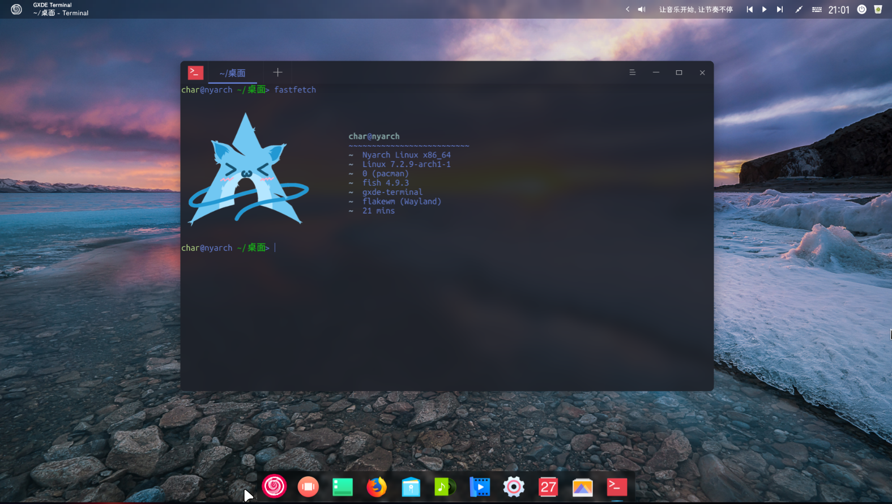

# GXDE Archlinux Packaging
> Welcome to GXDE on Archlinux!! We're currently trying our best effort to port GXDE on Arch!



## Introduction
Welcome to the Homepage of GXDE Archlinux packaging, this repository hosts all the packaging & CI for GXDE Arch.

Although we're not planning to provide a full Archlinux-based distro, we're now working on the Archlinux packaging.

## Installation
### AUR
> Currently, AUR packages are maintained by @CharOfString.
>
> The AUR packages complies everything from aource, so it is normal if the process took 3 hours.

Please install these packages:
```shell
$ paru -S gxde-dtk5-git gxde-dtk6-git gxde-dtk2-git gxde-dtk2-qt6-git gxde-infra-git gxde-core-git flakewm-git gxde-display-manager-git
```

And here is a list of optional packages:
- gxde-dtk5widget-dev-git
- spark-webapp-runtime-git
- gxde-voice-recorder-git
- gxde-system-monitor-git
- gxde-system-assistant-git
- gxde-screen-recorder-git
- gxde-roller-git
- gxde-reader-git
- gxde-picker-git
- gxde-ocr-git
- gxde-music-git
- gxde-log-viewer-git
- gxde-image-viewer-git
- gxde-hardware-viewer-git
- gxde-font-manager-git
- gxde-filetransfer-git
- gxde-editor-git
- gxde-dtk2widget-dev-git
- gxde-downloader-neo-git
- gxde-dlna-caster-git
- gxde-display-manager-git
- gxde-dict-git
- gxde-clone-git
- gxde-camera-git
- gxde-calendar-git
- gxde-calculator-git
- gxde-boot-maker-git
- flakewm-git
- dde-clipboard-git

### GXDE Archlinux Pacman Source
We provide an Archlinux pacman source at https://repo.gxde.top/gxde-arch/.

Currently the source is not signed. A sigining will be provided soon.

## Repository Branch
You may find this repository almost empty. That's completely normal for we use branches for different tasks. You will need to switch the branches to see the sub-projects.

### Active Branches
- **master**: This branch is for this welcome message.
- **aur**: Stores the AUR packaging info.
- **qt_version_probe**: The source code of a small probe that detects if the GXDE arch software's Qt version mismatches from Archlinux.

### Inactive Branch
- **dtk5_batchbuild_arch**: The batch build CI script for DTK5, now moved to this branch.

## License
You may find a license file on each branch, each license file is good for the corresponding branch only.
